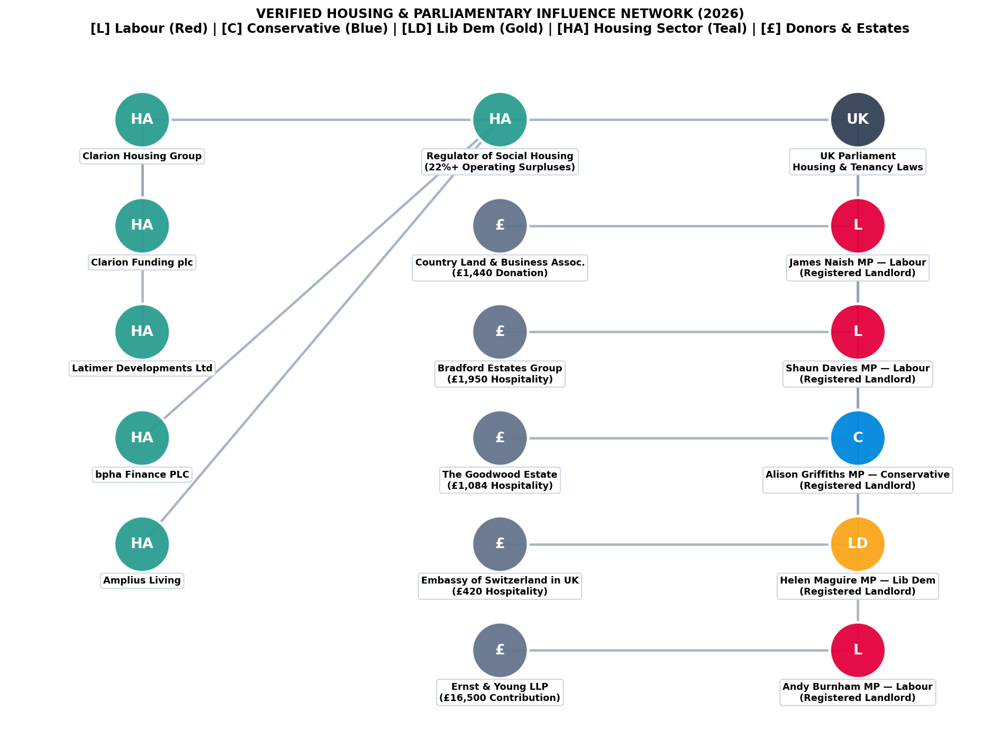

# THE HOUSING & PARLIAMENTARY NEXUS: CONFLICTS OF INTEREST INTELLIGENCE ENGINE

Welcome to an independent public intelligence asset exposing the financial intersections between **Parliament's Register of Members' Financial Interests**, **Companies House corporate filings**, and **Regulator of Social Housing statutory returns**.

---

## 🔍 KEY FINDINGS: WHAT THE LIVE DATA SHOWS (2026)

Cross-referencing official Westminster, Companies House, and housing regulator registries exposes a three-part structural loop in UK housing governance:

1. **Housing Associations Do Not Lobby With Direct Political Cash:** A 1,500-record forensic baseline check found **zero direct donations** from Clarion, bpha, or Amplius—or their 62 subsidiary directors—to sitting MPs. Because housing associations hold charitable/not-for-profit status, they retain massive operating surpluses (**22%+ margins**) and channel funds into executive pay (**£185,000 to £384,000+**) rather than direct party funding.
2. **A Large Bloc of Lawmakers Have Direct Financial Skin in the Game:** Westminster records verify **214 active property and rental disclosures** held by sitting MPs—creating a structural **conflict of interest** whenever housing reform or tenant protections are debated.
3. **Corporate Lobbying Flows Through Landlord Trade Groups & Commercial Networks:** Cross-referencing those 214 landlord MPs against Category 3 (Gifts, Benefits & Hospitality) uncovered **288 overlapping disclosures**—including direct hospitality and funding from property estates and landlord advocacy bodies such as the **Country Land and Business Association Limited**, **Bradford Estates Group Limited**, and **The Goodwood Estate**, alongside major advisory firms like **Ernst & Young LLP** and five-figure corporate backers.

---

## 🚨 LIVE INVESTIGATIVE BRIEFINGS & DATASETS (2026)

Click below to read the live, auto-generated investigative briefings pulled directly from official UK government registries:

* **[🏢 READ THE INDIRECT DONOR & SUPPLY-CHAIN BRIEFING (Corporate Donors Matched to Companies House & Landlord MPs)](./READABLE_INDIRECT_DONOR_SUPPLY_CHAIN_BRIEFING.html)**
* **[📄 READ THE 288 CONFLICTS OF INTEREST BRIEFING (Landlord MPs Accepting Gifts & Hospitality)](./READABLE_LANDLORD_MP_GIFTS_NEXUS.html)**
* **[📄 READ THE 214 VERIFIED MP LANDLORDS BRIEFING (Full Property & Rental Register)](./READABLE_MP_LANDLORD_BRIEFING.html)**
* **[👥 READ THE HOUSING ASSOCIATION TRUSTEES & BOARD BRIEFING (Clarion, bpha & Amplius)](./READABLE_HOUSING_TRUSTEES_AND_BOARD_BRIEFING.html)**
* **[🔍 READ THE FORENSIC BASELINE AUDIT: HOUSING DIRECTORS VS. PARLIAMENT (1,500-Record Check)](./READABLE_DIRECTOR_PARLIAMENT_AUDIT.html)**
* **[📊 VIEW THE SOCIAL HOUSING SURPLUS & CEO PAY MATRIX (Clarion, bpha & Amplicus)](./regulator_of_social_housing_statistical_data_return_matrix.csv)**

---

## 🕸️ INTERLOCKING GOVERNANCE NETWORK MAP

---

## The Anatomy of the "Not-for-Profit" Loophole

To the general public, the label "not-for-profit" implies a charitable enterprise operating entirely for the public good. In reality, within the social housing sector, it functions as a legal shield:

1. **The Executive Salary Loophole:** Excess cash generated from tenant rents is legally re-routed into astronomical executive wages—with top Housing Association Chief Executives pulling down **£185,000 to £384,000+ per year**.
2. **The "Surplus" Hoard:** What a commercial business calls "net profit," a housing association labels an **"Operating Surplus"**—averaging over **22%** across major providers like Clarion, bpha, and Amplicus while tenants face maintenance neglect.
3. **The Boardroom "Chumocracy":** Independent boards hire external remuneration consultancies to rubber-stamp executive wage spikes across their own industry circle.

This platform extracts that data out of fragmented government registries and presents the timeline to the public. **The data belongs to you.**

